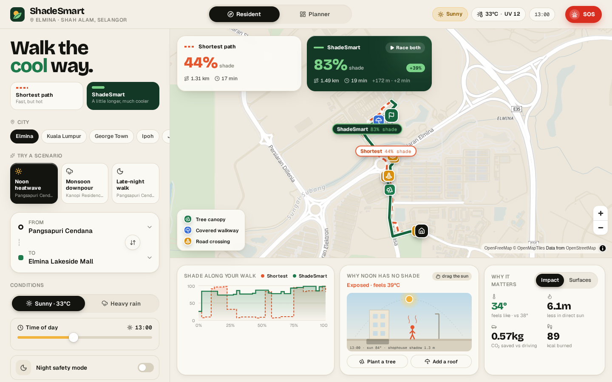
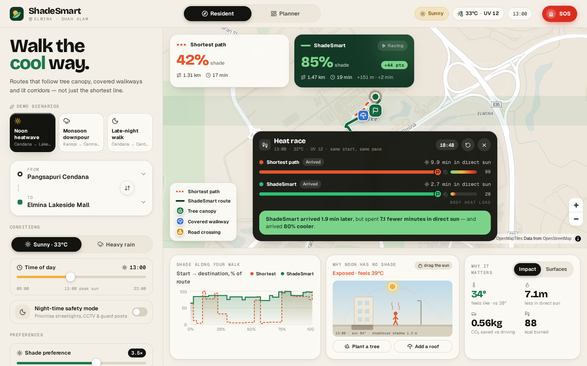
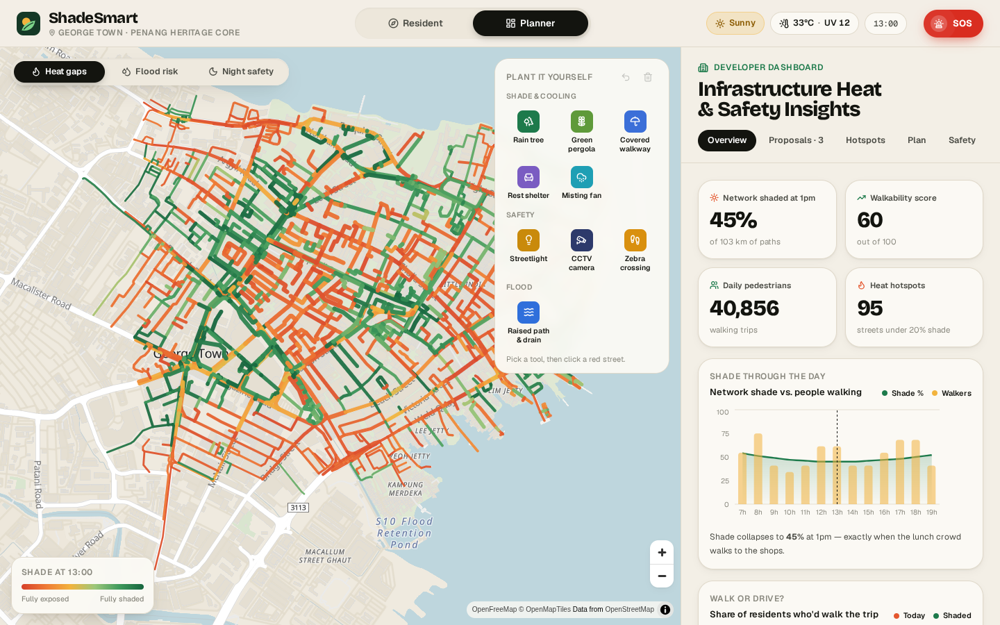
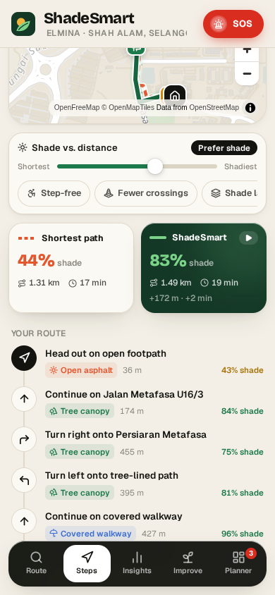
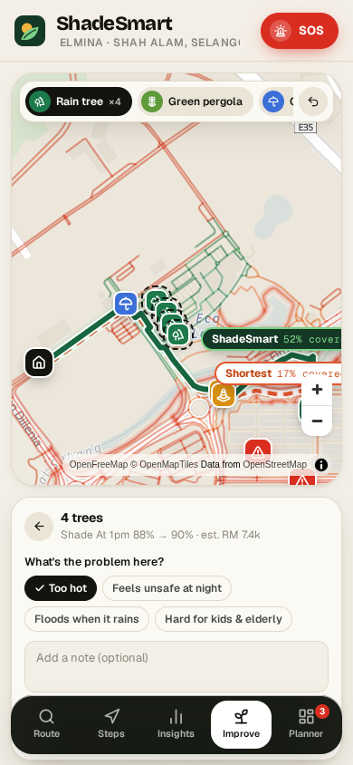

# ShadeSmart

**Heat-aware, safe and flood-resilient walking navigation for Malaysian townships.**

Map apps send you down the shortest line, even when that means 1.3 km of bare asphalt at 33 °C. ShadeSmart finds the walk that stays under trees and covered walkways by day, follows lit and watched streets at night, and routes around flooded underpasses in a downpour. It also gives township developers and city councils a live map of where shade, light and drainage are missing.

**Live demo:** https://shadesmart.vercel.app



> Hackathon prototype. Street geometry is real OpenStreetMap data. Shade, lighting, flood risk, footfall, guard posts, proposals and SOS history are **synthetic demo data**.

---

## Contents

- [The problem](#the-problem)
- [Features](#features)
  - [Resident app (B2C)](#resident-app-b2c)
  - [Planner dashboard (B2B)](#planner-dashboard-b2b)
- [Cities](#cities)
- [How routing works](#how-routing-works)
- [Data](#data)
- [Tech stack](#tech-stack)
- [Getting started](#getting-started)
- [Project structure](#project-structure)
- [Deployment](#deployment)
- [Demo script](#demo-script)
- [Credits and licence](#credits-and-licence)

---

## The problem

- **Too hot to walk.** Malaysian residents drive even 400 m trips because walking means direct sun at peak UV.
- **Heat stress** hits children, the elderly and wheelchair users hardest.
- **Developers plant blind.** Townships spend millions on trees and covered walkways without knowing which paths people use or where shade is missing.
- **Safety and floods.** Dark shortcuts at night and flash-flooded underpasses during monsoon rain make walking worse still.

## Features

### Resident app (B2C)

| | |
|---|---|
| **Two routes side by side** | The plain shortest path (red, dashed) against the ShadeSmart route (green, solid). Labels on the map show each route's shade %. |
| **Sunny mode** | Shade changes with the time of day: trees, covered walkways, and building shadow that shrinks towards noon. |
| **Rain mode** | Flood-prone, low-lying paths are blocked and marked *"Blocked due to flood risk — Rerouted"*. Covered walkways are preferred. |
| **Night safety mode (CPTED)** | Routes along lit streets with CCTV coverage. Shows streetlights, CCTV and guard posts. The map darkens as the time slider passes dusk. |
| **Preferences** | A shade-vs-distance slider (Fastest → Max shade), plus Step-free (avoids stairs), Fewer crossings, and a shade layer that colours every path. |
| **Turn-by-turn steps** | "Turn right onto Persiaran Metafasa", with turn arrows, a surface tag (tree canopy, covered, building shade, open asphalt), distance and shade %. |
| **Route markers** | Icons for tree canopy, covered walkways, road crossings, step-free stretches, and anything the route avoided (stairs, crossings, dark paths, floods). |
| **Heat race** | Two walkers set off together on both routes, with live sun-exposure and body-heat meters and a verdict at the end. |
| **Why noon has no shade** | A draggable sun-and-shadow street scene. Plant a tree or add a roof and watch the pedestrian cool down. |
| **Insights** | Shade along the walk (chart), surface mix, feels-like temperature, minutes saved in direct sun, CO₂ saved vs driving. |
| **Suggest improvements** | Place rain trees, pergolas, covered walkways, rest shelters, misting fans, streetlights, CCTV, zebra crossings or raised drains on the map, see the predicted gain, and send the proposal to the developer or council. Its status updates when they decide. |
| **SOS (Township Guardian)** | Tap for a 5-second countdown, or hold to send silently. Shares live GPS with the local auxiliary police and nearest guard post, with a patrol ETA. |



### Planner dashboard (B2B)

| | |
|---|---|
| **Heat Gap map** | Every path coloured by shade at 1 pm, the township's worst hour. Line width shows daily footfall. |
| **Flood risk & night safety layers** | Flood-prone paths, dark corridors, streetlights, CCTV and guard posts. |
| **Overview** | Network shade, walkability score, daily pedestrians, number of heat hotspots, a shade-through-the-day chart, path surface mix, a liveability radar, and a **walk-or-drive** curve showing how many car trips shade would win back. |
| **Hotspots** | Streets under 20 % shade at noon, ranked by people × exposure. |
| **Intervention simulator** | Set trees, metres of covered walkway and streetlights, then see the cost in RM, shade before/after, % walkability gain, and residents helped. |
| **Plant it yourself** | Click 9 kinds of item onto the map. The heat map and resident routes update live. |
| **Resident proposals** | An inbox of residents' suggestions with notes, supporter counts and predicted impact. **Approve** or **Decline**; approved items go straight onto the map. |
| **Capital plan** | A budget tracker against an RM 1.5M landscape budget, plus impact per RM 100k. |
| **Safety** | Dark corridors (CPTED priority), flash-flood watch, and a recent SOS log with response times. |
| **City picker** | Switch the dashboard between all 9 cities. |



### Mobile and tablet

Below 1024 px the layout changes:
- The map card sits at the top, with weather/time (or route preferences) directly underneath so you can watch the map react.
- A floating bottom nav switches between **Route · Steps · Insights · Improve · Planner**.
- Tool pickers become slide-up sheets or slim strips, and panels open below the map so it is never covered.

<p>
  
  
</p>

## Cities

| City | Area modelled | Proposals go to |
|---|---|---|
| Elmina | Shah Alam, Selangor (Sime Darby township) | Sime Darby Property |
| Kuala Lumpur | Bukit Bintang – KLCC | DBKL |
| George Town | Penang heritage core | MBPP |
| Ipoh | Old & New Town | MBI |
| Johor Bahru | City centre | MBJB |
| Melaka | Heritage city | MBMB |
| Putrajaya | Presint 1 – 2 | PPj |
| Kota Kinabalu | City centre | DBKK |
| Kuching | Waterfront | DBKU |

Use the city chips, or type any landmark in **From / To**. The search covers every city, so typing *"Chew Jetty"* while in KL loads George Town and flies the map there. Each city has three demo trips: noon heatwave, monsoon downpour and late-night walk.

## How routing works

The street network is a weighted graph, and Dijkstra runs twice:

- **Shortest path:** cost = distance.
- **ShadeSmart path:**

```
cost = distance × (1 + (1 − coverage) × (weight − 1) × 1.5)
```

| Mode | `coverage` means |
|---|---|
| Sunny | shade at the chosen hour (tree canopy + covered walkway + building shadow, which shrinks towards noon) |
| Rain | roof cover; flood-prone segments are removed from the graph entirely |
| Night | lighting, plus a penalty for streets without CCTV |

`weight` is the shade-vs-distance slider: 1.0 gives the shortest path, 5.0 maximum shade. Step-free mode removes stairs and unpaved trails. Fewer crossings adds a penalty at every arterial crossing.

## Data

- **Streets** are real [OpenStreetMap](https://www.openstreetmap.org/) data (© OpenStreetMap contributors, ODbL), fetched through the Overpass API.
- **Attributes** come from deterministic rules in `scripts/build-graph.mjs`, so every build is reproducible:
  - parks → tree canopy; shopping areas → covered five-foot ways; arterials → exposed but well lit;
  - footpaths near water → flood-prone;
  - footfall estimated from nearby landmarks;
  - a few hand-picked demo trips per city, made so the shaded alternative is clearly visible.
- **Basemap** tiles come from [OpenFreeMap](https://openfreemap.org/) and need no API key.
- No backend, no auth, no database. Proposals and plans live in memory and reset on refresh.

## Tech stack

- [Vite](https://vite.dev/) + React 19 + TypeScript
- [Tailwind CSS v4](https://tailwindcss.com/)
- [MapLibre GL JS](https://maplibre.org/) for vector maps and route rendering
- [Recharts](https://recharts.org/) for charts
- [Motion](https://motion.dev/) for animation
- [Lucide](https://lucide.dev/) icons
- Fonts: Bricolage Grotesque (display), Geist and Geist Mono

## Getting started

Requires Node 20+.

```bash
git clone https://github.com/Nitteswaran/shadesmart.git
cd shadesmart
npm install
npm run dev          # http://localhost:5173
npm run build        # type-check + production build into dist/
npm run preview      # serve the production build
```

### Regenerating city data

City graphs are already committed in `public/cities/`. To rebuild them, or to add a city:

```bash
# 1. add or edit an entry (id, name, bbox) in scripts/cities.mjs
node scripts/fetch-osm.mjs [cityId ...]   # download OSM extracts into data/osm/<city>/
node scripts/build-graph.mjs [cityId ...] # build public/cities/<city>.json + src/data/cities.json
```

Keep each bounding box to about 1.5 km on a side, so the graph stays small enough to load quickly on phones.

## Project structure

```
scripts/
  cities.mjs          city list and bounding boxes
  fetch-osm.mjs       Overpass downloader
  build-graph.mjs     OSM → walk graph + synthetic attributes + places + demo trips
data/osm/<city>/      raw OSM extracts (inputs)
public/cities/        built city graphs, fetched on demand
src/
  App.tsx             city loader, app state, desktop / mobile layouts
  lib/
    engine.ts         graph, shade/rain/light model, Dijkstra, route stats
    cities.ts         city manifest + lazy loading
    directions.ts     turn-by-turn instructions
    features.ts       route markers and labels
    placements.ts     placeable items and their effect on the network
    planner.ts        corridor stats, interventions, KPIs
    proposals.ts      resident proposals (seeded per city)
    daylight.ts       time-of-day map tint
  components/
    MapView.tsx       MapLibre map, layers, markers, camera
    Navigate.tsx      resident panel, comparison cards, insights
    Planner.tsx       developer dashboard
    Propose.tsx       resident proposals + planner inbox
    Race.tsx          heat race
    SunShadow.tsx     draggable sun & shadow scene
    WalkOrDrive.tsx   walk-or-drive curve
    SOS.tsx           Township Guardian SOS
    Chrome.tsx        header, toasts, mobile bottom nav
    icons.tsx, ui.tsx shared icons and UI primitives
```

## Deployment

The app is deployed on **Vercel** as a static Vite site. The GitHub repo is connected, so every push to `main` deploys to production automatically. To deploy by hand:

```bash
npx vercel deploy --prod
```

## Demo script

1. **Noon heatwave:** the shortest path is 44 % shaded, ShadeSmart 83 % for about 150 m extra. Press **Race both** and watch the body-heat meters.
2. Drag the **time slider** (or the sun in *Why noon has no shade*) through the day, and past dusk into night mode.
3. **Monsoon downpour:** flooded segments appear as red markers and the route goes around them.
4. **Late-night walk:** the map darkens and the route switches to lit, CCTV-covered streets.
5. **Improve:** plant trees on a red street and send the proposal.
6. **Planner:** open the proposal, approve it, and watch the heat map turn greener. Switch cities with the city picker.
7. Press **SOS**.

## Credits and licence

- Street data © [OpenStreetMap contributors](https://www.openstreetmap.org/copyright), available under the Open Database License.
- Map tiles by [OpenFreeMap](https://openfreemap.org/), © OpenMapTiles.
- Built as a hackathon prototype for heat-resilient township planning. Not affiliated with or endorsed by Sime Darby Property or any city council named above.
